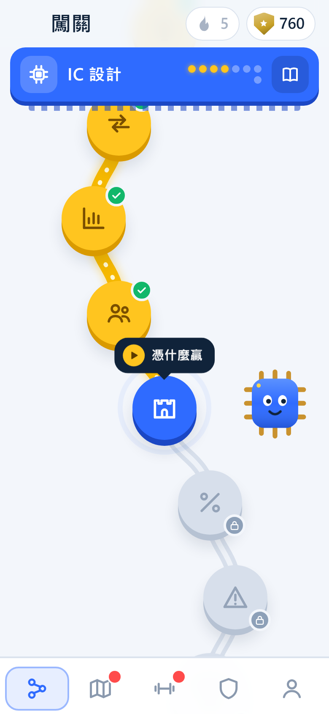
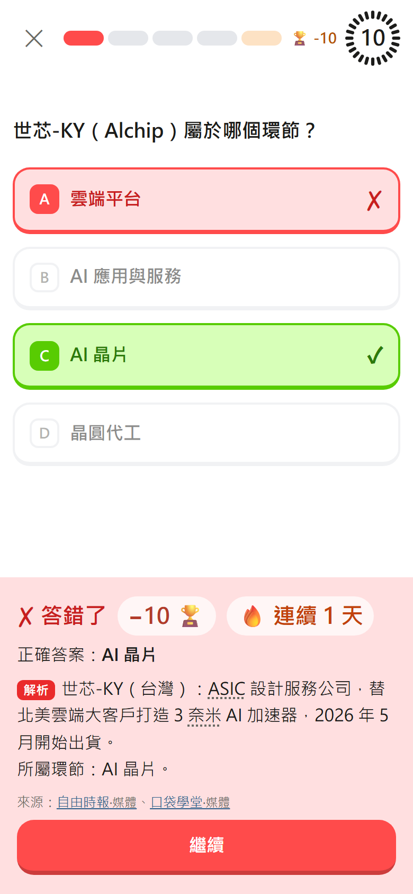
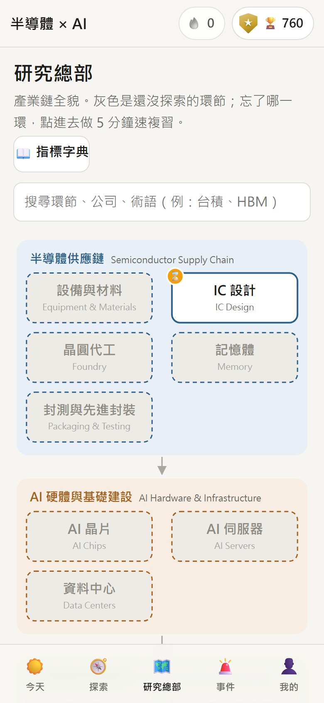

# 半導體 × AI 產業學習 App

**Semiconductor × AI Industry Learning App**

用遊戲的方式，幫商管背景的人從零開始看懂半導體與 AI 產業：一章一章探索、用段位和盃數練習、跟著重大事件學、隨時回到產業鏈地圖複習。

🔗 **線上版：https://dannyyao-maker.github.io/semiconductor-ai-map/**　（手機可以「加到主畫面」，像 App 一樣使用，沒有網路也能學）

> 狀態：學習 App 第一版。章節內容已有 4 章（IC 設計、晶圓代工、封測與先進封裝、記憶體與 HBM），其他 7 章陸續製作中；內容由 Claude Code 整理並附來源，尚待本人審核。

| 今天 | 事件任務（圖表） | 答題 | 研究總部 |
| --- | --- | --- | --- |
|  |  |  |  |

> An interactive, gamified learning app for the semiconductor and AI value chain, built for business readers. Static site (no backend, no API keys), installable as a PWA, with sourced content, rank-based quizzes, and event missions generated from official filings and checked automatically against the original documents. Built with Claude Code.

## 這個專案在解決什麼問題

產業資訊很零散、技術門檻又高，看新聞時常常不知道它在講產業鏈的哪一段，也不知道該看哪些財務指標。這個 App 的做法是：

- **先給結構，再練判斷。** 先花 3 分鐘看「一顆 AI 晶片的旅程」，再從產業鏈的起點 IC 設計開始，一個環節一個環節往旁邊走。
- **每一章都問同一組問題**，這也是評估一家公司之前需要知道的事：它在做什麼、錢怎麼流、市場多大、誰是玩家、憑什麼贏、怎麼賺錢、現在的挑戰。
- **只講商業面**，不講製程和規格；不構成任何投資建議。

## 功能

| 功能 | 說明 |
| --- | --- |
| 探索章節 | 全景開場 → 一章一章往相鄰環節解鎖。探索選擇不計分，答題才計分 |
| 段位與盃數 | 青銅到 PRO 共 8 個段位 22 階。越往上，答對加得越少、答錯扣得越多、題目時間越短；不會掉出已達到的大段位 |
| 答題 | 先出題目、再出選項、倒數計時；答對綠色、答錯紅色，附正確答案和解析；結束有「本局複習」 |
| 連續天數 | 每天完成一題計分題才算一天，連續 3、7、14、30 天當天盃數加倍 |
| 事件任務 | 重大事件（法說會、財報、政策）整理成任務：圖表簡報 → 地圖導覽 → 影響矩陣 → 看圖題 |
| 研究總部 | 產業鏈地圖。沒探索的環節是灰色（霧），學過才亮起來；超過 7 天沒複習會提醒；每個環節有 5 分鐘速複習和 30 秒速覽 |
| 指標字典 | 22 個財務指標（EPS、本益比、利息保障倍數、毛利率……）的定義、公式、偏高偏低的意義，以及在半導體產業的特殊情況 |
| 可安裝 | PWA：加到手機主畫面、全螢幕、離線可用 |

## 內容怎麼查證

- **每條內容附來源連結和資料時間點（asOf）**，並標示審核狀態：`待查證` → `待審核` → `已審核`。
- 官方資料（SEC 的 10-K／20-F／6-K、法說會逐字稿、政府公告）一個來源就夠；二手資料要有兩個獨立來源。
- 查證時直接下載官方文件全文，逐句對照。查證過程記錄在 [查證報告.md](查證報告.md)（找到 1 句與事實衝突、約 27 處找不到根據的內容，已更正或刪除）。
- **事件任務有自動檢查**（[tools/check-event.mjs](tools/check-event.mjs)）：事件裡每個數字都要在引用的原始文件找得到，推算的數字要標明；官方事件只能引用官方來源；二手事件要有兩個獨立發布者，而且不能把傳聞當事實。檢查不過就不能上線。

## 技術選擇

| 層次 | 選擇 | 為什麼 |
| --- | --- | --- |
| 網站 | 純 HTML／CSS／JavaScript，不用框架、不用打包 | GitHub Pages 直接放，好維護 |
| 圖表與地圖 | 自己畫的 SVG／HTML | 完全控制；圖表依 dataviz 準則：藍橘配色（避開紅綠）、財測用虛線、每張圖附數據表 |
| 內容 | `data/*.json` | 內容和程式分開，改內容不用改程式 |
| 學習進度 | 瀏覽器 localStorage，可匯出／匯入 | 不需要帳號和後端 |
| 離線與安裝 | Service Worker + manifest（PWA） | 免費、不用上架審核 |
| 內容產生與查證 | Claude Code（訂閱額度） | 不使用任何付費 API 金鑰 |
| 上線 | GitHub Pages | 免費 |

## 在自己電腦上打開

需要 [Node.js](https://nodejs.org)，不用另外安裝任何套件。

```bash
node tools/serve.mjs
```

然後打開 http://localhost:8000 。不能直接雙擊 `index.html`，因為瀏覽器基於安全限制，直接開檔案時讀不到 `data/`。網址加上 `?dev#/me` 會出現測試工具（直接設定盃數、模擬連續天數）。

## 資料夾結構

| 路徑 | 用途 |
| --- | --- |
| `index.html`、`css/`、`js/` | 網站本體（`js/views/` 是五個頁面，`js/charts.js` 是圖表） |
| `data/` | 環節、公司、來源、術語、章節、事件、指標、遊戲規則（欄位說明見 [data/README.md](data/README.md)） |
| `manifest.webmanifest`、`sw.js`、`icons/` | 可安裝的 App 與離線快取 |
| `tools/` | 本機預覽、SEC 下載、原文搜尋、PDF 取文字、監看新文件、事件自動檢查 |
| `.claude/commands/` | `/更新地圖`（每季更新內容）、`/新事件`（找新事件並整理成任務） |
| `sources/` | 下載的原始文件，只存在本機，不上傳（著作權） |
| [提案.md](提案.md)、[決策紀錄.md](決策紀錄.md)、[優化盤點.md](優化盤點.md)、`學習模式提案*.md`、[來源清單.md](來源清單.md)、[查證報告.md](查證報告.md) | 規劃與過程紀錄 |

## 用 Claude Code 打造的流程

這個專案從規劃到上線都是用 [Claude Code](https://claude.com/claude-code) 完成的。我負責定義問題、做決定；Claude Code 負責寫程式、整理內容和查證。每個重要決定都記錄在 [決策紀錄.md](決策紀錄.md)。

| 階段 | 產出 |
| --- | --- |
| 0–5 | 產業鏈地圖：11 個環節、41 家公司、27 個術語、83 個來源，逐條查證後上線 |
| 優化盤點 | 介面、內容時效、效能與無障礙的盤點（[優化盤點.md](優化盤點.md)） |
| 學習模式 | 三版提案，定案為「探索章節＋段位盃數＋事件任務＋研究總部」 |
| 學習 App | 資料模板、五個頁面、段位與答題、全景開場與 IC 設計章、指標字典、研究總部改版 |
| 事件任務 | 圖表化的事件簡報、影響矩陣、看圖題；來源監看與自動檢查 |
| PWA | 可安裝、離線可用 |

## 授權與聲明

- 程式碼：[MIT License](LICENSE)
- 內容（章節、事件、公司小卡、術語、指標字典、文件）：[CC BY 4.0](LICENSE-CONTENT.md)，使用時請註明出處
- 原始資料（年報、法說會、新聞）的著作權屬於各自的發布者；本專案只放改寫後的摘要和原始連結。
- 內容僅供學習參考，**不構成任何投資建議**。

作者：danny（[@dannyyao-maker](https://github.com/dannyyao-maker)）
