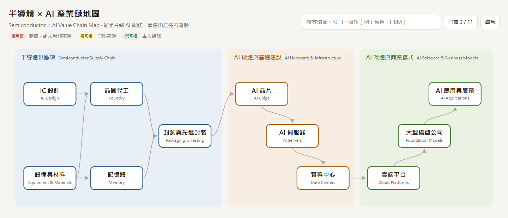
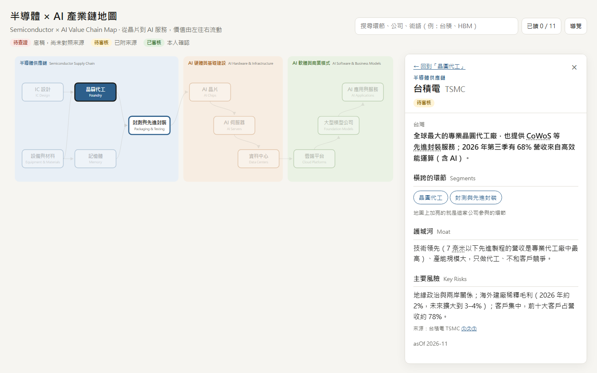
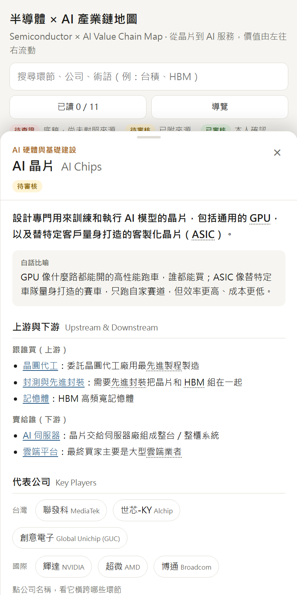

# 半導體 × AI 產業鏈互動地圖

**Semiconductor × AI Value Chain Map**

一張可以點擊的產業鏈地圖，幫商管背景的人在 30 分鐘內建立半導體與 AI 產業的全貌：每個環節在做什麼、誰是代表公司、怎麼賺錢、議價能力強不強、現在遇到什麼問題。

🔗 **線上版：https://GITHUB_USER.github.io/semiconductor-ai-map/**



> An interactive map of the semiconductor and AI value chain for business readers: 11 segments, 41 companies and 27 glossary terms, each claim backed by a source link (27 of 83 sources are official filings such as 10-K / 20-F and earnings call transcripts). Built from scratch with Claude Code as a static site.

## 這個專案在解決什麼問題

產業資訊很零散，技術門檻又高，看新聞時常常不知道它在講產業鏈的哪一段。這張地圖先給「結構」：

- **全景層**：一張圖看完 11 個環節、三大區塊（半導體供應鏈 → AI 硬體與基礎建設 → AI 軟體與商業模式）。
- **環節層**：點一個環節，看它的商業模式、利潤高低、議價能力、當前問題和熱門話題。
- **公司層**：點代表公司，地圖會加亮這家公司橫跨的所有環節。例如台積電同時在晶圓代工和先進封裝，微軟同時在雲端、模型和應用。

只講商業面，不講製程和規格。

| 環節卡與公司小卡 | 手機版 |
| --- | --- |
|  |  |

## 內容規模與查證

| 項目 | 數量 |
| --- | --- |
| 環節卡 | 11 張 |
| 公司小卡 | 41 家（台灣 19 家） |
| 術語解釋 | 27 個 |
| 來源 | 83 個，其中 27 個是官方一手資料 |

**每條內容都附來源連結和資料時間點（asOf）**，並標示審核狀態：`待查證`（底稿）→ `待審核`（已對照來源）→ `已審核`（本人讀過、確認看得懂）。

查證規則：

- **官方一手資料**（美國證券交易委員會 SEC 的 10-K／20-F 年報、法說會逐字稿、官方新聞稿）一個來源就夠。查證時直接下載年報全文，逐句對照原文。
- **二手資料**（新聞、研究筆記）至少要有兩個獨立來源，或追到官方原文。
- **找不到根據的句子一律刪除或改寫**；意見性的句子（例如「市場討論 AI 是否過熱」）改成有來源的事實。

查證的成果：找到 1 句跟事實衝突的內容。底稿原本寫「IC 設計毛利率通常高於代工」，但台積電毛利率約 66%，比多數 IC 設計公司還高，已經更正。另外改寫或刪除了約 27 處找不到根據的內容。完整紀錄在 [查證報告.md](查證報告.md)。

## 功能

- 可點擊的 SVG 產業鏈地圖（電腦版由左到右，手機版直排）
- 環節卡、公司小卡，地圖加亮公司橫跨的環節
- 術語解釋：卡片裡的專有名詞（HBM、CoWoS、ASIC……）點一下看白話說明
- 搜尋環節、公司、術語，中英文都可以
- 「我讀懂了」已讀進度，存在瀏覽器裡，不需要帳號
- 第一次進站的 4 步驟新手導覽
- 網址記住目前開的卡片（例如 `#foundry/tsmc`），可以直接分享某一張卡

## 技術選擇

| 層次 | 選擇 | 為什麼 |
| --- | --- | --- |
| 網站 | 純 HTML／CSS／JavaScript，不用框架 | 不用安裝、不用打包，GitHub Pages 可以直接放，好維護 |
| 地圖 | 程式讀資料、自己畫的 SVG | 只有 11 個節點，自己畫才能完全控制點擊和加亮效果 |
| 內容 | `data/*.json` | 內容跟程式分開，改內容不用改程式 |
| 學習進度 | 瀏覽器 localStorage | 不用註冊帳號、不用後端 |
| 內容產生與查證 | Claude Code（訂閱額度） | 不使用任何付費 API 金鑰 |
| 上線 | GitHub Pages | 免費 |

## 用 Claude Code 打造的流程

這個專案從規劃到上線都是用 [Claude Code](https://claude.com/claude-code) 完成的。我負責定義問題、做決定、審核內容；Claude Code 負責寫程式、整理內容和查證。每個重要決定都記錄在 [決策紀錄.md](決策紀錄.md)。

| 階段 | 產出 |
| --- | --- |
| 0 規劃 | 技術選擇、資料夾結構、11 個環節定案 |
| 1 地圖骨架 | 可點擊的地圖，加上 3 張示範環節卡 |
| 2 內容補齊 | 11 張環節卡、41 家公司的底稿 |
| 查證 | 對照 83 個來源逐條查證；建立查證規則與 [查證報告](查證報告.md) |
| 3 來源串接 | 查證工具，加上 `/更新地圖` 指令，用台積電 2026 年第三季法說會試跑 |
| 4 體驗打磨 | 搜尋、術語解釋、已讀進度、導覽、手機與平板版面 |
| 5 上線 | GitHub Pages、作品集 README |

**每季更新**：在專案資料夾啟動 Claude Code，輸入 `/更新地圖`。它會找出新的法說會和年報，只處理有變動的內容，並把改了什麼寫進查證報告。流程定義在 [.claude/commands/更新地圖.md](.claude/commands/更新地圖.md)。

## 在自己電腦上打開

需要 [Node.js](https://nodejs.org)，不用另外安裝任何套件。

```bash
node tools/serve.mjs
```

然後打開 http://localhost:8000 。不能直接雙擊 `index.html`，因為瀏覽器基於安全限制，直接開檔案時讀不到 `data/` 裡的資料。

## 資料夾結構

| 路徑 | 用途 |
| --- | --- |
| `index.html`、`css/`、`js/` | 網站本體 |
| `data/` | 環節、公司、來源、術語（欄位說明見 [data/README.md](data/README.md)） |
| `tools/serve.mjs` | 本機預覽用的小伺服器 |
| `tools/sec-fetch.cjs` | 從 SEC 查詢、下載公司官方年報與季報 |
| `tools/find-text.cjs` | 在官方文件裡找關鍵字，印出原句 |
| `tools/pdf-text.cjs` | 從文字型 PDF（例如法說會逐字稿）取出文字 |
| `tools/review-list.mjs` | 產生可以打勾的 [審核清單](審核清單.md) |
| `sources/` | 下載的原始文件，只存在本機，不上傳（著作權） |
| [提案.md](提案.md)、[決策紀錄.md](決策紀錄.md)、[來源清單.md](來源清單.md)、[查證報告.md](查證報告.md) | 規劃與過程紀錄 |

## 授權與聲明

- 程式碼：[MIT License](LICENSE)
- 內容（環節卡、公司小卡、術語、文件）：[CC BY 4.0](LICENSE-CONTENT.md)，使用時請註明出處
- 原始資料（年報、法說會、新聞）的著作權屬於各自的發布者；本專案只放改寫後的摘要和原始連結。
- 內容僅供學習參考，**不構成任何投資建議**。

作者：danny
